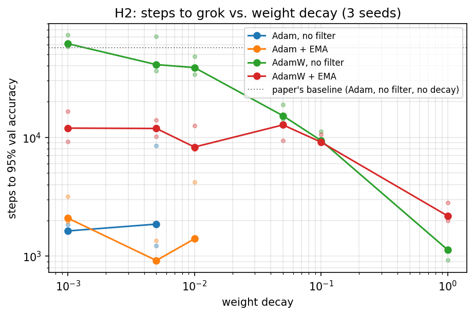

# H2: is it the weight decay, or the filter?

The paper's headline comparison changes two things at once: its baseline uses no weight
decay, while Grokfast-MA and Grokfast-EMA use 0.01 and 0.005. H2 asks how much of the speedup
tuned weight decay gives on its own.

Run on a Colab T4 on 2026-10-30 from the `salman` branch, with the `h2` grid in
`notebooks/grokfast_experiments.ipynb` (section 6). Same task and model as the replication
(x·y mod 97, 2-layer Transformer, 50/50 split, lr 1e-3, batch 512), seeds 0–2, 75 runs:

- **optimizer:** Adam, where weight decay is added to the gradient (coupled L2, what the
  paper's `main.py` does), and AdamW, where it's applied separately (decoupled)
- **weight decay:** 0, 0.001, 0.005, 0.01, 0.05, 0.1, 1.0
- **filter:** none, and Grokfast-EMA (α 0.98, λ 2)

Runs stop once validation accuracy has stayed at or above 95% for 1,000 steps, or at 100k
steps. Runs whose training accuracy is still below 50% at step 20k are stopped and counted as
failures. The weight decay 0, no-filter cell is the replication baseline.

We report two numbers per run: **first reach**, the first step with validation accuracy
≥ 95% (the paper's metric), and **stable**, the first step after which it stays ≥ 95% for
1,000 steps.

## Results

Medians over 3 seeds, in thousands of steps (per-seed values in `results/h2/`; "fail" means
fewer than 2 of 3 seeds got there).

**First reach 95%**

| Weight decay | Adam, no filter | Adam + EMA | AdamW, no filter | AdamW + EMA |
|---|---|---|---|---|
| 0 | 56.8 | 9.5 | (same as Adam) | (same as Adam) |
| 0.001 | **1.6** | 2.1 | 61.3 | 11.9 |
| 0.005 | 1.9 | **0.9** | 40.9 | 11.9 |
| 0.01 | fail | 1.4 | 38.6 | 8.3 |
| 0.05 | fail | fail | 15.2 | 12.7 |
| 0.1 | fail | fail | 9.4 | 9.1 |
| 1.0 | fail | fail | **1.1** | 2.2 |

**Stable at 95% for 1,000 steps**

| Weight decay | Adam, no filter | Adam + EMA | AdamW, no filter | AdamW + EMA |
|---|---|---|---|---|
| 0 | 67.3 | 9.8 | (same as Adam) | (same as Adam) |
| 0.001 | **10.0** | 6.5 | 66.1 | 12.2 |
| 0.005 | 17.9 | 6.3 | 46.0 | 11.9 |
| 0.01 | fail | **4.8** | 38.7 | 8.3 |
| 0.05 | fail | fail | 15.9 | 13.3 |
| 0.1 | fail | fail | 10.3 | 9.1 |
| 1.0 | fail | fail | fail (1 of 3: 15.9) | 8.2 |

For reference, Grokfast-MA at the paper's settings (from the replication) reaches 95% at
**0.9k** and is stable from the same step.

## What we found

1. **Tuned weight decay alone gives almost all of the "first reach" speedup.** The paper
   compares Grokfast to a baseline with no weight decay (56.8k steps). With decay tuned and no
   filter at all, the model first reaches 95% in 1.1k steps (AdamW, 1.0) or 1.6k (Adam, 0.001),
   against 0.9k for the best Grokfast setting. The gap shrinks from about 60× to about 1.2×.

2. **The filters make grokking stick, and decay alone doesn't.** After first reaching 95%,
   almost every fast setting collapses briefly, sometimes to under 10% validation accuracy,
   before recovering. Requiring 95% to hold for 1,000 steps, the best no-filter setting needs
   about 10k steps, Grokfast-EMA 4.8–6.3k, and Grokfast-MA only 0.9k (it never collapsed).
   AdamW at weight decay 1.0, the fastest to first reach 95%, stayed stable in only 1 of 3 seeds.

3. **With Adam, the filter changes the effective strength of weight decay.** Grokfast amplifies
   the loss gradient (by up to 1 + λ = 3×) *before* Adam adds the decay term, so the same
   nominal decay is relatively weaker. Without the filter, Adam fails to fit the training set
   at decay 0.01 and above; with it, 0.01 works fine (1.4k). The best decay moves from 0.001
   (no filter) to 0.005–0.01 (filter), roughly the factor of 3 you'd expect. Part of what looks
   like a filter effect in the paper is this change in regularization.

4. **Without enough decay, the filter helps a lot.** At weight decay 0 it cuts first reach
   from 56.8k to 9.5k steps (6×), and with AdamW at small decay from about 61k to 12k. It acts
   partly as a substitute for regularization.

5. **At AdamW's best decay, the filter slows first reach** (1.1k → 2.2k) but makes the result
   stable (8.2k vs. failing in 2 of 3 seeds).

## What this means for the paper's claim

The paper's 50× compares Grokfast plus weight decay with a baseline that has none. Against a
baseline with tuned weight decay, Grokfast's advantage in *first reaching* 95% mostly
disappears. Its advantage in *staying* generalized is real, especially for the MA filter.
That's a narrower claim than the paper makes, and it points to stability, not raw speed, as
what the slow-gradient filter buys.

## Caveats and next steps

- 3 seeds per cell; several cells vary 2–3× between seeds.
- Learning rate was fixed at 1e-3 (the paper's value) for every setting, so the baselines
  aren't fully tuned either.
- The grid only tests Grokfast-EMA. Grokfast-MA was the most stable setting here, so the next
  step is to add MA to the weight-decay grid.
- H1 (next) tests whether the filter's benefit comes from slow gradient components
  specifically, using high-pass and random-direction controls at the same gain.
