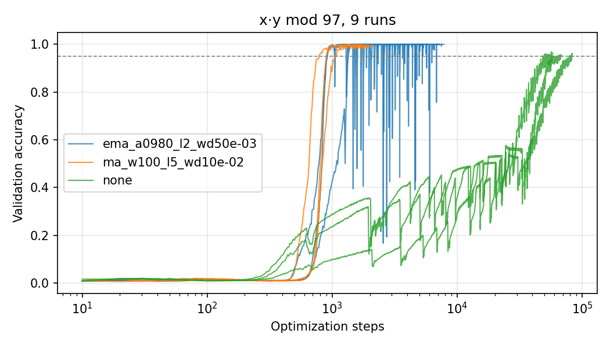

# Replication: x·y mod 97 (3 seeds)

Run on a Colab T4 on 2026-10-30 from the `salman` branch (commit 4ee4bb4). Same setup as
the paper and the official `main.py`: 2-layer decoder-only Transformer, 50/50 train/val
split, Adam (β = 0.9, 0.98), lr 1e-3, batch 512, validation checked every 10 steps.
Seeds 0, 1, 2 (the seed also sets the train/val split).

Each run stopped once validation accuracy had stayed at or above 95% for 1,000 steps
(`--stop_threshold 0.95 --stop_patience 1000`), with a 200k-step cap. Every run reached
the threshold.

| Method | Settings | Steps to 95% val (seeds 0, 1, 2) | Median | Paper |
|---|---|---|---|---|
| Baseline | no filter, weight decay 0 | 56,800, 79,640, 48,650 | **56,800** | 39,890 |
| Grokfast-MA | window 100, λ 5, weight decay 0.01 | 790, 900, 1,050 | **900** | 790 |
| Grokfast-EMA | α 0.98, λ 2, weight decay 0.005 | 910, 1,350, 920 | **920** | 910 |

"Steps to 95%" is the first evaluation at or above 95%.



## What we see

- **Grokfast's step counts reproduce.** Seed 0 matches the paper exactly for both MA (790)
  and EMA (910), on Mac, Windows CPU and a Colab T4.
- **The baseline is slower than the paper and varies a lot.** Median 56,800 steps, range
  48,650 to 79,640. All three seeds are slower than the paper's 39,890, so the paper's
  single baseline run was on the fast side. Using medians, the speedup is about **63×
  (MA)** and **62× (EMA)**, so a bigger gap than the paper's 50×. With one seed per
  method, though, the ratio can land anywhere from about 46× to 100×.
- **Grokfast-EMA is unstable after it groks.** It crosses 95% around step 900, then
  repeatedly crashes to 20 to 40% validation accuracy and recovers (see the plot). It
  took until steps 5,760 to 7,840 to hold 95% for 1,000 steps. MA was steady. The paper
  doesn't mention this, and "steps to first reach 95%" hides it.
- **The baseline only barely groks within these runs.** It stopped just above 95%
  (max 95.6 to 96.9%) and climbs in a sawtooth with sudden drops, which looks like the
  "slingshot" behavior reported for Adam by Thilak et al. (2022).

## Caveats

- 3 seeds is enough to see the spread, not to pin it down.
- The comparison is still confounded with weight decay (0 vs 0.01 / 0.005), which is
  what H2 tests next.
- Validation accuracy is also the stopping signal, so there's no separate test split yet.

Reproduce the table and plot with:

```bash
python analysis/summarize_runs.py results/replication --plot docs/figures/replication_val_acc.png
```
